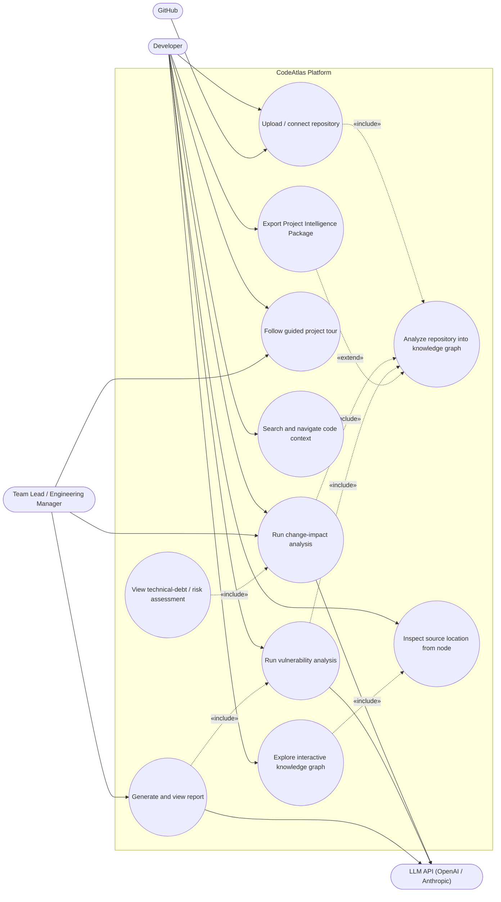

# Use Case Diagram — CodeAtlas

Actors and use cases for the CodeAtlas platform, derived from the proposal's six-module
MVP scope. Use cases implemented in the F1 prototype are marked **(F1)**; the remainder
are planned for later phases.

## Actors

| Actor | Role |
| --- | --- |
| **Developer** | Primary user — uploads/connects a repository, explores the graph, runs impact and vulnerability analysis, exports intelligence. |
| **Team Lead / Engineering Manager** | Uses tours and reports to onboard new hires and review proposed changes before commits. |
| **GitHub** | External system — source for connected repositories. |
| **LLM API** | External supporting actor — explains findings and drafts remediation; never determines graph structure. |

## Use cases

| Use case | Status | Description |
| --- | --- | --- |
| Upload / connect repository | **F1** | Upload a JS/TS repository ZIP (proposal adds GitHub connect). |
| Analyze repository into knowledge graph | **F1** | Parse via Babel/TS Compiler API, extract entities and relationships, build and store the graph. |
| Explore interactive knowledge graph | **F1** | Zoom, pan, drag, click nodes in a React + D3 force-directed view. |
| Inspect source location from node | **F1** | Node details panel shows type, file path, and line range. |
| Follow guided project tour | Planned | Step-by-step walkthrough of important execution flows. |
| Search and navigate code context | Planned | Graph-aware search across files, classes, functions, routes. |
| Run change-impact analysis | Planned | Natural-language requirement → validated entities → deterministic graph traversal → impact report. |
| View technical-debt / risk assessment | Planned | Requirement-specific risk from coupling, depth, cycles, complexity. |
| Run vulnerability analysis | Planned | Scoped static security-rule analysis mapped to entities. |
| Generate and view report | Planned | Vulnerability/impact reports with evidence and remediation. |
| Export Project Intelligence Package | Planned | Portable JSON / Markdown / CSV output. |

> **F1 prototype note:** only the AST knowledge-graph and interactive exploration use cases are
> implemented. All analysis, tour, search, security, export, and AI use cases are proposal scope
> for later phases.
