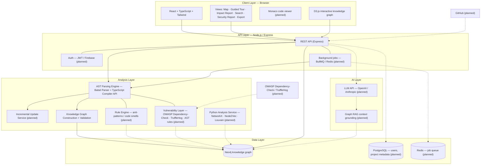
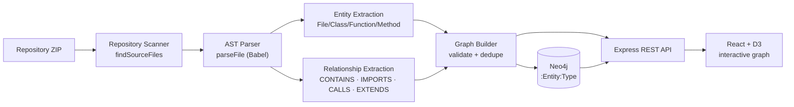

# Architecture Diagram — CodeAtlas

Layered architecture as described in the proposal's *System Architectural Design*, with the
F1 prototype's implemented path highlighted. Solid boxes are implemented in F1; dashed boxes
are planned.

## Layers

| Layer | Responsibility | F1 status |
| --- | --- | --- |
| **Client** | Browser UI — graph visualization, source inspection, reports. | React + D3 implemented. |
| **API** | Express REST API; auth and background jobs in the proposal. | REST implemented; auth/jobs planned. |
| **Analysis** | AST parsing, graph construction, rule/security analysis, graph algorithms. | AST engine + graph construction implemented; rules/security/Python planned. |
| **AI** | Grounded LLM for explanation and remediation; no model training. | Planned. |
| **Data** | Neo4j graph; PostgreSQL metadata; Redis queue. | Neo4j implemented. |

## F1 end-to-end pipeline (implemented)

The prototype's concrete, verified flow:

### Design principles (from the system guide)

- The **backend builds the graph**; the frontend only renders what the API returns.
- Graph IDs use **repository-relative paths**; physical filesystem paths are never exposed.
- **One bad file never aborts analysis** (per-file fault tolerance).
- **Persistence is best-effort** — if Neo4j is down the graph is still returned
  (`persisted: false`).

### Verification tooling (F1)

The prototype is covered by an automated test suite and three quality gates:

- **Vitest + Supertest** — specs in `backend/src/__tests__` driven by fixture repositories in
  `backend/src/test-fixtures`.
- **Gates** — `npm test`, `npm run typecheck` (`tsc --noEmit`), and `npm run build`
  (`tsc -p tsconfig.build.json`, which excludes tests/fixtures from `dist`).
- **Edge provenance** — every relationship records how it was found (`resolution` =
  `derived` | `resolved` | `name-match`, plus `filePath` / `line`), persisted as Neo4j
  relationship properties.
- **Relevance scope** — `classify.utils` + `scope.service` annotate every node with a `category`
  (File nodes) and `inDefaultScope` flag; the frontend filters are reversible and never delete
  graph data.
- **Dark UI** — the interface uses a near-black navy theme with a restrained cyan accent and a
  selection-only glow.
