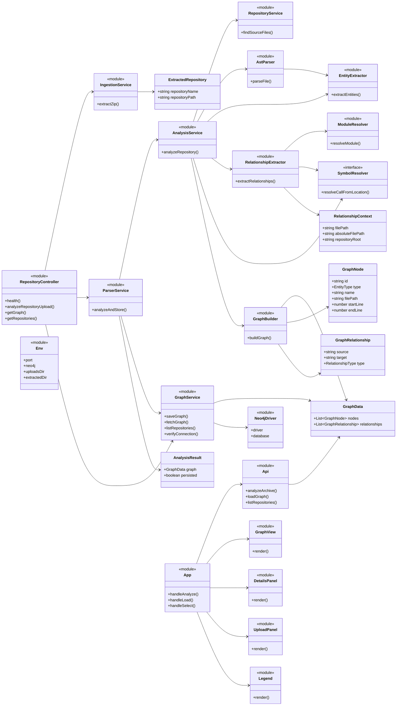
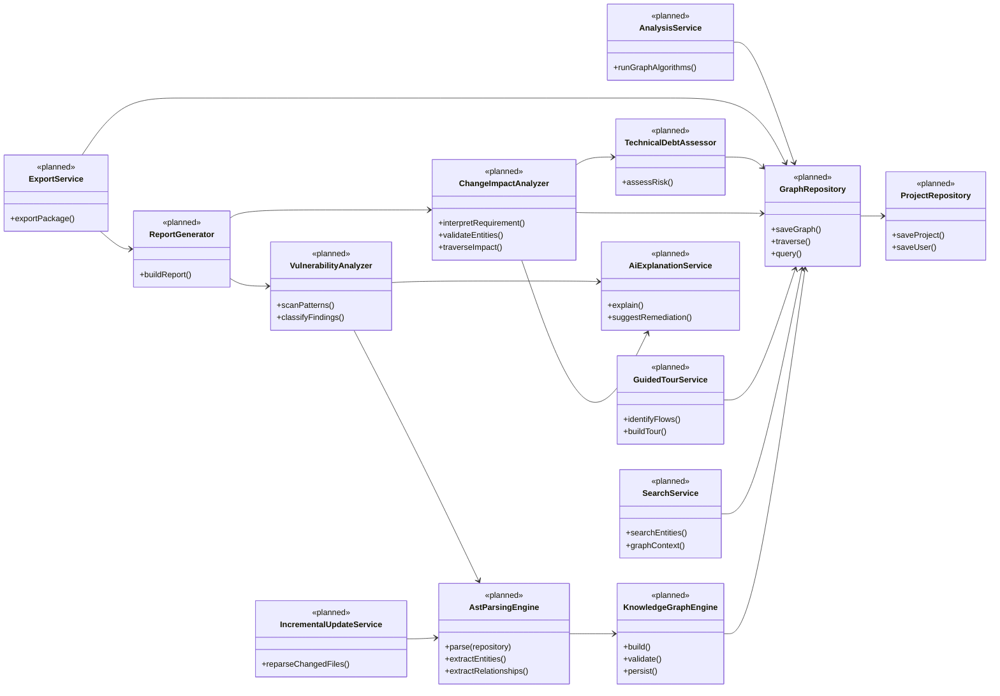

# Class Diagram — CodeAtlas

Two views:

1. **Implemented F1 class structure** — the concrete TypeScript modules (functions grouped
   into logical classes), verified from `backend/src/**` and `frontend/src/**`.
2. **Proposed service layer** — the classes the proposal's six-module MVP implies.

## 1. Implemented (F1 prototype)

`<<module>>` marks a TypeScript module presented as a class; methods are its exported
functions.

## 2. Proposed service layer (six-module MVP)

Classes implied by the proposal's scope. `<<planned>>` = not yet implemented in F1.

> **Mapping:** the F1 `GraphService`, `AnalysisService`, `AstParser`, `EntityExtractor`,
> `RelationshipExtractor`, and `GraphBuilder` correspond to the front half of the proposed
> `KnowledgeGraphEngine` / `AstParsingEngine`. The remaining proposed classes are future work.
