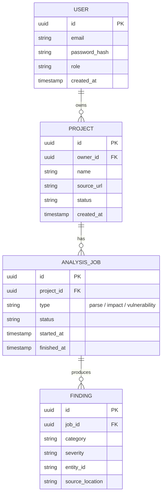

# ERD / Graph Data Model — CodeAtlas

CodeAtlas stores repository structure in **Neo4j**, a labelled property graph. Every node
carries the `:Entity` label plus its specific type label (e.g. `:Entity:Function`), and every
node also stores a `repository` property used to scope queries. The diagram below expresses
that schema as an entity-relationship model with attributes and cardinalities.

## Knowledge graph schema (Neo4j)

```mermaid
erDiagram
    REPOSITORY {
        string id PK "repository:name"
        string name
        string source "upload or github (planned)"
    }
    DIRECTORY {
        string id PK "directory:path"
        string name
        string filePath
    }
    FILE {
        string id PK "file:path"
        string name
        string filePath
        int startLine
        int endLine
        string category "source|test|config|fixture|generated|declaration"
        boolean inDefaultScope
    }
    CLASS {
        string id PK "class:path:Name"
        string name
        string filePath
        int startLine
        int endLine
    }
    FUNCTION {
        string id PK "function:path:Name"
        string name
        string filePath
        int startLine
        int endLine
    }
    METHOD {
        string id PK "method:path:Class:Name"
        string name
        string filePath
        int startLine
        int endLine
    }
    API_ROUTE {
        string id PK "route:path:method (planned)"
        string method
        string path
    }

    REPOSITORY ||--o{ DIRECTORY : CONTAINS
    REPOSITORY ||--o{ FILE : CONTAINS
    DIRECTORY ||--o{ DIRECTORY : CONTAINS
    DIRECTORY ||--o{ FILE : CONTAINS
    FILE ||--o{ CLASS : CONTAINS
    FILE ||--o{ FUNCTION : CONTAINS
    CLASS ||--o{ METHOD : CONTAINS
    FILE ||--o{ FILE : IMPORTS
    CLASS ||--o{ CLASS : EXTENDS
    FUNCTION ||--o{ FUNCTION : CALLS
    METHOD ||--o{ METHOD : CALLS
    FUNCTION ||--o{ METHOD : CALLS
    METHOD ||--o{ FUNCTION : CALLS
    FILE ||--o{ API_ROUTE : DEFINES
```

### Node types and identity

| Node | Identity (`id`) | Emitted in F1 |
| --- | --- | --- |
| Repository | `repository:<name>` | Yes |
| Directory | `directory:<relativePath>` | Yes |
| File | `file:<relativePath>` | Yes |
| Class | `class:<path>:<Name>` | Yes |
| Function | `function:<path>:<Name>` | Yes |
| Method | `method:<path>:<Class>:<Name>` | Yes |
| Variable / Object | reserved | No (reserved type only) |
| API route | planned | No |

### Relationship types

| Relationship | Meaning | F1 |
| --- | --- | --- |
| `CONTAINS` | Structural ownership (repository/dir/file → child). | Yes |
| `IMPORTS` | A file imports a local file. | Yes |
| `CALLS` | A function/method calls another (via TS symbol resolution). | Yes |
| `EXTENDS` | A class extends another (matched by name). | Yes |
| `MUTATES` / data-flow | Proposal-scope richer relationships. | Planned |

Each relationship may also carry **provenance** properties — `resolution`
(`derived` | `resolved` | `name-match`), plus `filePath` and `line` — recording *how* the edge
was discovered (`CONTAINS`→`derived`, `IMPORTS`/`CALLS`→`resolved`, `EXTENDS`→`name-match`).

> IDs are **repository-relative** and globally unique within one analysed repository;
> physical filesystem paths are never exposed in the graph.

## Comparison: Node.js / PostgreSQL metadata (planned)

The proposal adds PostgreSQL for user accounts and project metadata, alongside the graph
store. The relational model is:



### Notes

- Neo4j holds the **structural knowledge graph** (the core F1 output); PostgreSQL holds
  **accounts and job/report metadata**.
- `FINDING.entity_id` references a Neo4j node `id`, linking relational findings to graph
  entities — this is how the proposal surfaces risk *in context* on the graph.
- F1 implements the **Neo4j schema only**; the PostgreSQL model, auth, and findings are
  planned.
