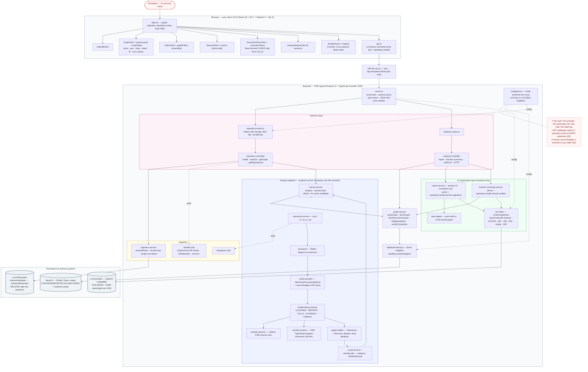

# D2 Diagram 1 — Current System Architecture (verified)

**As of Build 04, 2026-10-20.** Every box below is drawn from source in this repository —
see `../01-audit-and-requirements.md` §I.1 for the file/line evidence of each one. No
proposed component appears here.

| Style | Meaning on this diagram |
| --- | --- |
| Solid box | ✅ implemented & verified in source |
| Rounded/cylinder | 🔌 external system actually used today |
| Dashed red | a real **absence** that must not be mistaken for a feature |

## Reading notes (what a reviewer should take from this)

1. **One process, one deployment.** The backend is a layered monolith — Interface →
   pipeline/AI services → persistence. Nothing here is a separate service, and
   `../02-architecture-current-target.md` §D.1 recommends it stays that way.
2. **The backend owns all graph semantics.** The client only renders what the API returns;
   the sole exception is `executionFlows.ts`, which derives *display* pipelines from the
   `CALLS` edges it was given (that's the W8 gap in the master doc, not a second graph
   builder).
3. **Two outbound dependencies only**: Neo4j (bolt) and the LLM provider (HTTPS). Both are
   reachable only from the backend — no client arrow touches them.
4. **The red dashed box is part of the architecture picture**, not an editorial comment: it
   is why the whole target layer in `D2` is blocked on identity decisions (E1, E2, E3).
5. **Persistence is best-effort** — `parser.service` returns the graph with
   `persisted:false` if Neo4j is down, so the pipeline is demonstrable without a database.

➡️ Target-state diagrams (2, 3, 4, 8, 9) stay undrawn until
[`../08-approval-gate.md`](../08-approval-gate.md) §J.3 is answered.
