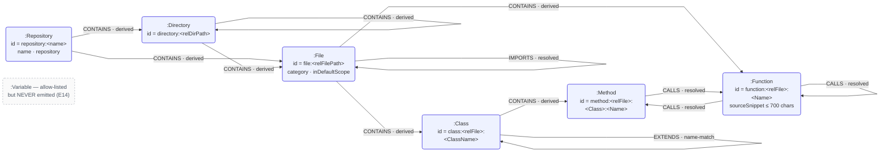
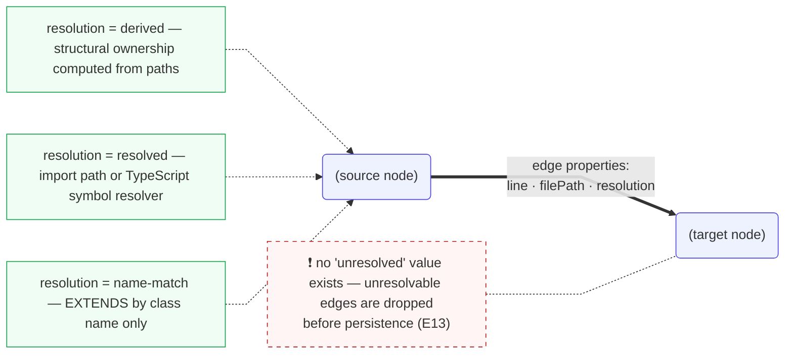
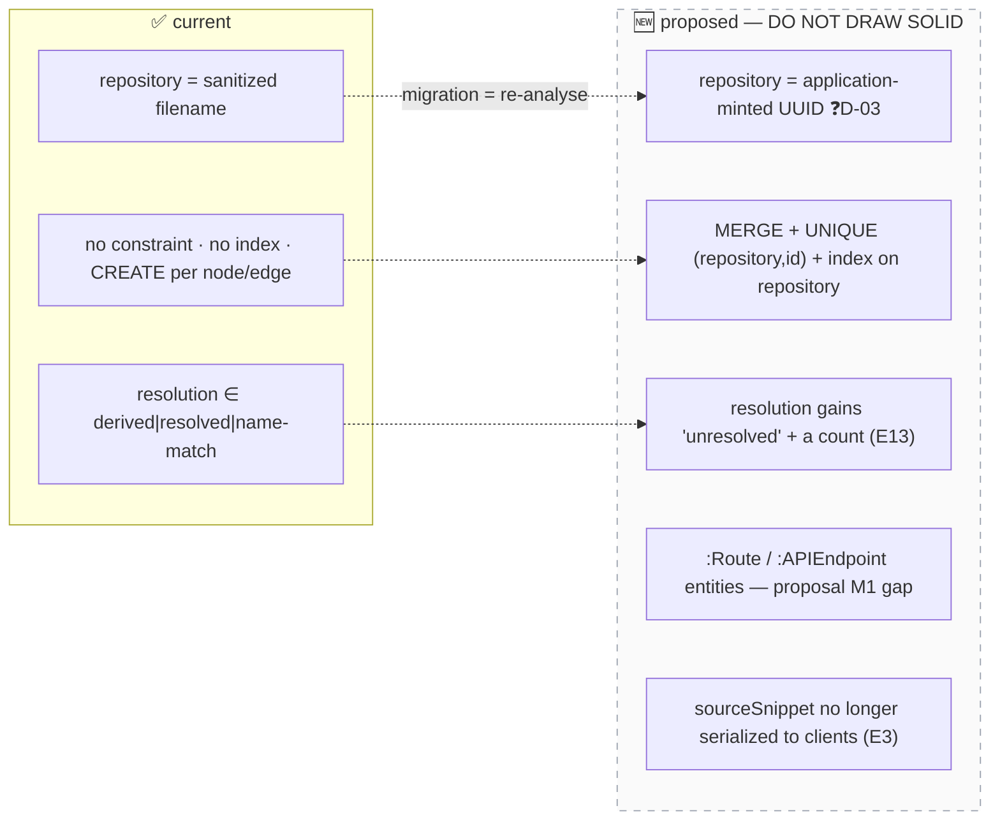

# D2 Diagram 7 — Current Neo4j Data Model (verified from the real Cypher)

Every label, property, direction and behaviour below was read out of
`backend/src/services/graph.service.ts`, `models/graph.types.ts` and
`backend/src/parser/graph.builder.ts`. There is **no schema file and no migration** in this
repository — this model exists only as the write path.

## 1. The graph as it is actually stored

All nodes also carry the `:Entity` super-label (plus their type label), and the ten
properties written verbatim by `saveGraph`: `id`, `type`, `name`, `filePath`, `startLine`,
`endLine`, `category`, `inDefaultScope`, `sourceSnippet`, `repository`.

## 2. Relationship properties (provenance)

## 3. Identity, keys and integrity — the verified state

| Concern | Reality in code | Draw consequence |
| --- | --- | --- |
| Node id | Application-generated **string**, repository-relative | ids are unique **only within one `repository` value** |
| Uniqueness constraint | **None** — `CREATE`, never `MERGE`; no `CREATE CONSTRAINT` anywhere | Partial/duplicate writes are possible; nothing enforces `(repository, id)` |
| Indexes | **None**; every `MATCH (n:Entity {repository:…})` / `{id:…}` is a scan | Write path is ~1 statement per node + 2 lookups per edge (E5) |
| Scoping mechanism | The `repository` **property** — value = sanitized filename (E1) | Same name across users ⇒ mutual deletion. Identity change D-03 is blocking |
| Re-analysis | `MATCH (n:Entity {repository:$r}) DETACH DELETE n` then re-create | Idempotent per name; other repositories untouched |
| Unscoped read | `fetchGraph()` with no argument returns **all** `:Entity` nodes | `GET /api/graph` can expose every repository (E2) |
| Content exposure | `fetchGraph` re-attaches `sourceSnippet` to returned nodes | Private source fragments leave the server (E3) |
| Function context | `fetchFunctionContext` collects `(caller)-[:CALLS]->(n)` and `(n)-[:CALLS]->(callee)` into a **set of names** | Same-name callees merge (E17) |
| Ownership registry | `listRepositories()` = `DISTINCT r.name` on `:Repository` | No owner, timestamps or run history — the relational layer's job |

## 4. Proposed overlay (draw dashed grey, blocked)

Blocked by **D-03** (identity) and **D-05** (retention). Nothing in §4 may appear as solid
until `../08-approval-gate.md` §J.3 is answered.

➡️ Diagram index and render steps: [`README.md`](./README.md)
