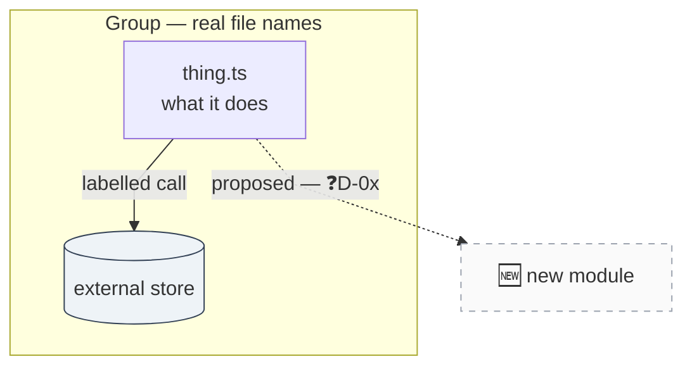

# Mermaid diagrams — what exists and how to produce the rest (step by step)

## 1. Where the Mermaid code lives

| Location | Diagrams | State |
| --- | --- | --- |
| [`../../D1/`](../../D1/README.md) | `01-use-case.md`, `02-architecture.md`, `03-class.md`, `04-erd.md` | ✅ Mermaid code already in the repo (round-1 diagrams, proposal-aligned) |
| [`./`](.) (this folder) | `D01-current-system-architecture.md`, `D07-current-neo4j-model.md` | ✅ newly drawn from verified source — no approvals needed |
| [`../06-diagram-blueprints.md`](../06-diagram-blueprints.md) | The other 8 diagrams | 📐 **blueprints only** — deliberately not drawn, because `../08-approval-gate.md` §J.3 has unanswered decisions |

`D2` had no Mermaid at all before this folder: the discovery brief said *produce the
specification first and wait for approval*, so diagrams 2, 3, 4, 6, 8, 9 (and 10) stay
undrawn until the owner answers. Diagram 1 and Diagram 7 are pure description of existing
code, so they can be drawn today.

## 2. See a diagram right now (no install)

1. **VS Code** — open `D01-current-system-architecture.md`, press `Ctrl+Shift+V`.
   Markdown preview renders ` ```mermaid ` blocks natively.
2. **GitHub** — push and open the file; GitHub renders Mermaid automatically.
3. **mermaid.live** — copy the code *inside* the fences (not the fences), paste at
   <https://mermaid.live>, get live render + Share/Download buttons and a PNG/SVG/PDF export.

## 3. Export a file to an image (this repo, Windows)

```bat
cd docs\diagrams\D2\diagrams

:: one-time: downloads the CLI and a bundled Chromium (~200 MB, needs network)
npx -y @mermaid-js/mermaid-cli@11 --version

:: SVG — best for the report (scales, stays crisp in Word/PDF)
npx -y @mermaid-js/mermaid-cli@11 -i D01-current-system-architecture.md -o export\D01.svg

:: PNG for slides
npx -y @mermaid-js/mermaid-cli@11 -i D01-current-system-architecture.md -o export\D01.png

:: everything in this folder at once
for %f in (*.md) do npx -y @mermaid-js/mermaid-cli@11 -i "%f" -o "export\%~nf.svg"
```

Notes learned the hard way:

- A Markdown file with **several** mermaid blocks renders each block to its own numbered
  output (`D07-…-1.svg`, `D07-…-2.svg`). That's why `D07` is split into separate blocks.
- Put exports in `export/` so generated images never get confused with source.
- Rendering fails on an **unquoted** special character in a label. Anything containing
  `:` `(`/`)` `#` `/` `,` goes inside quotes — `A["id = file:&lt;path&gt;"]`. Angle brackets
  become `&lt;` `&gt;`. That is what `D01`/`D07` do throughout.
- `&` between node ids is *Mermaid syntax* (`A --> B & C`), never text.

## 4. Getting a diagram into draw.io (the brief's final target)

Two routes, in order of reliability:

**Route A — image import (fast, what most FYP reports do)**
1. Export the SVG with the command in §3.
2. draw.io → **File → Import from → Device…** → pick the SVG (or drag the SVG onto the canvas).
3. It arrives as one embedded image. Resize freely; it stays sharp.
4. To edit properly, keep the `.md` Mermaid file as the source of truth and re-export
   whenever you change it — never hand-edit the image.

**Route B — native Mermaid insert (editable shapes)**
1. draw.io → **Insert → Advanced → Mermaid…** (in older builds: **Extras → Insert → Mermaid**;
   if neither exists in your version, use Route A).
2. Paste the code from inside the fences, click **Insert**.
3. draw.io converts it to objects you can restyle, then **Extras → Edit Diagram** lets you
   tune the XML.
4. Re-check the status convention (§5) after conversion — conversion can flatten dashed
   borders and fills, which is the one thing that must survive into the final figure.

**Route C — pure draw.io** (only if the supervisor insists on native draw.io for everything)
1. Build from `../06-diagram-blueprints.md`: it already lists the exact boxes, arrows,
   decision diamonds and error paths, so it is a drawing script.
2. Use one layer per status (`Solid-verified`, `Proposed`, `External`, `Unresolved`) so
   status can be toggled and reviewed; name the shapes with real file names from
   `../01-audit-and-requirements.md` §I.1.
3. Save the `.drawio` next to the Mermaid source (`../../D2/diagrams/`) so both are in git.

## 5. Status convention (identical on every D2 diagram — do not drift)

| Meaning | Mermaid style | draw.io equivalent |
| --- | --- | --- |
| ✅ implemented & verified | solid border, light blue fill (`stroke:#4f46e5`) | solid border, blue fill |
| 🔌 external system used today | cylinder `[( )]`, grey-blue fill | shape=cylinder + grey fill |
| 🆕 proposed, no code | `stroke-dasharray` grey, no colour fill | dashed border, no fill + «proposed» stereotype |
| ❓ unresolved decision | dashed red, label carries the D-id (`❓D-03`) | dashed red border + D-id in the label |
| 🟡 partially implemented | dashed amber | dashed amber border |
| Absence that must not be misread | red dashed box with ❗ (see the `NOAUTH` node in `D01`) | red dashed callout |

Every diagram keeps a legend box and a caption **"as of Build 04, 2026-10-20"**.

## 6. Producing the remaining diagrams — the actual order of work

| Step | Action | Gate |
| --- | --- | --- |
| 1 | ✅ Diagram 1 (current architecture) — done in `D01` | none |
| 2 | ✅ Diagram 7 (current Neo4j model) — done in `D07`; **current state only**, proposed overlay stays dashed | D-03 to make the overlay solid |
| 3 | Diagram 6 (UML class/module) — can be drawn next: every solid class in it already has file/line evidence in `../01-audit-and-requirements.md` §I.1, and the future panel is labelled separately | none for the solid half |
| 4 | Diagram 5 (processing + AI execution) — the verified half (Flows 2, 3, 4 of `../03-execution-flows.md`) is drawable now | D-04/D-03/D-05 for the 🆕 steps |
| 5 | Diagrams 2, 3, 4, 8 (target architecture, user workflow, admin workflow, ERD) | **blocked**: D-16, D-01, D-03, D-06, D-11, D-14 |
| 6 | Diagram 9 (subscription/usage/payment) | **blocked**: D-07, D-08, D-10, D-15 |
| 7 | Diagram 10 (deployment) | **recommend not drawing** — no Dockerfile, no CI, no hosting decision (D-13) |

If you want to move fast: answer **D-16** (does the SaaS layer belong in this FYP) and
**D-03** (repository identity as a UUID). Those two unlock steps 5 and 6; the rest can be
drawn as dashed-with-D-id placeholders in the meantime.

## 7. Rules that keep these diagrams defensible in review

1. Nothing solid appears unless it is listed in `../01-audit-and-requirements.md` §I.1
   with a real file (and ideally a line) reference.
2. Proposed items are dashed **and** carry their requirement id (`UR-08`) or decision id
   (`D-03`) in the label — a reviewer must be able to see why it is dashed.
3. No invented payment provider, price, quota number, identity product, class or table name.
4. No client arrow ever points at Neo4j, PostgreSQL or the credential store directly.
5. A generated implementation plan is drawn as *advice*, never as a code change.
6. Quota is three separate metrics (retained bytes / graph data / generated text) wherever
   it appears.
7. Audit events, analysis history, AI reports and the user-visible work log are four
   different boxes, never one "logs" box.
8. Before drawing anything target-state, run the ten consistency checks in
   `../06-diagram-blueprints.md` §H.1.

## 8. Skeleton to copy for the next diagram

```text
# D2 Diagram N — <name> (<verified | target>)

<one line: which D2 file it comes from, and what evidence backs the solid parts>

| Style | Meaning |
| --- | --- |
…legend table…



## Reading notes
…3-6 bullets a supervisor can challenge…
```

➡️ Pack index: [`../README.md`](../README.md) · Blueprints: [`../06-diagram-blueprints.md`](../06-diagram-blueprints.md) · Decisions: [`../05-decisions-open-questions.md`](../05-decisions-open-questions.md)
